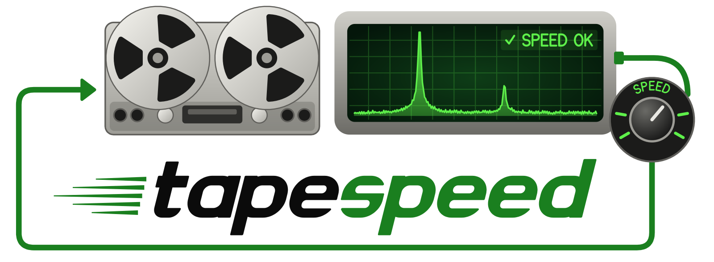
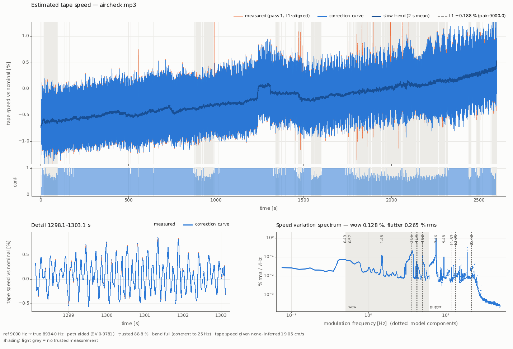

<p align="center">
  <picture>
    <source media="(prefers-color-scheme: dark)" srcset="docs/logo/png/header-dark.png">
    <source media="(prefers-color-scheme: light)" srcset="docs/logo/png/header-light.png">
    
  </picture>
</p>

# tapespeed

No tape machine ever ran at exactly the right speed. Motors drift as they warm up, capstans
are never perfectly round, and reels pull harder when they are full than when they are almost
empty. On playback this turns into a slightly wrong pitch (drift), a slow wavering (wow) and a
fast warble (flutter) — and it stays baked into every digitised transfer.

**tapespeed takes that wobble out again.** It looks for a tone that was recorded on the tape by
accident and should have been perfectly steady: the 19 kHz pilot of an FM stereo broadcast,
the 9 or 10 kHz whistle between neighbouring AM stations, the 15.6 kHz whine of a television
set in the room, or a test tone. Because that tone's true frequency is known, every wobble it
shows is the tape's fault. tapespeed measures the wobble, builds a speed curve for the whole
recording, and plays the audio back at exactly the inverse speed — so the tone, and the music
with it, becomes steady again.

## What you get

For each recording, tapespeed writes

- the **corrected audio** (FLAC, WAV, MP3, … — whatever the output file name says),
- a **speed plot** that shows how the tape actually ran, with wow and flutter figures,
- the **speed curve** as CSV and a **report** as JSON, for anyone who wants the numbers.

It can also remove the reference whistle itself, cut away the neighbour-station noise above an
AM broadcast, and notch out Morse code that sneaked into a recording.

## See it in action

Here is a real example: a 43-minute recording of the offshore station Radio Caroline from April
1979, taped off medium wave on a reel-to-reel deck and later shared as an MP3.

**Step 1 — ask what's on the tape.** The survey samples the file, lists the steady tones it can
find, checks which of them wobble together with the tape, and suggests a command line
(shortened here):

```text
$ tapespeed aircheck.mp3 --survey

CANDIDATES
   #     f Hz class   nom   off %  pres  C/N0  ...  verdict
   1   8916.3 AM     9000  -0.930 12/12  39.4  ...  trackable     whistle between two AM stations
   2  15595.7 TV    15625  -0.188 12/12  33.9  ...  trackable     a TV set in the room
COHERENCE
    8916.3  15595.7  ...  0.968  0.992  0.986  yes (tape)       both wobble the same way
PAIR
  -> found: d 65.97 Hz, beats 8934.03 / 9065.97 Hz               both neighbour stations audible
RECOMMEND
  cmd: tapespeed 'aircheck.mp3' --ref 9000 --abs pair --check-line 15625 --lowpass --auto-notch -o 'aircheck_corrected.flac'
```

Two independent rulers were found, and they agree: the whistle between neighbouring AM stations
and the line whistle of a television set. Because both neighbour stations are audible, tapespeed
can even work out the absolute speed without trusting the 1970s transmitter to be on frequency.

**Step 2 — correct it.** Running the suggested command writes the corrected audio and this plot:



The top panel shows how fast the tape really ran over the whole 43 minutes: a slow drift of about
one percent from start to end, a short jump near the 20-minute mark (confirmed by the TV whistle,
so it really happened on the tape), and on top of everything a broad band of fast flutter. The
detail at the bottom left zooms into five seconds: the deck's capstan wobbled about 7.5 times a
second by ±0.5 %. The spectrum at the bottom right breaks the wobble down by speed — the sharp
peaks are the turning parts of the machine. All of that is now gone from the corrected file.

The [user guide](docs/USER_GUIDE.md) walks through this example in detail and explains how to read
every part of the survey and the plot.

## Getting started

tapespeed needs [ffmpeg](https://ffmpeg.org) for reading and writing audio files
(`brew install ffmpeg` on macOS, `sudo apt install ffmpeg` on Debian/Ubuntu).

**Ready-made binaries** for macOS (Apple Silicon and Intel) and Linux (x86_64 and ARM64) are on the
[releases page](https://github.com/dg1yfe/tapespeed/releases). Download the archive for your
system, unpack it and put `tapespeed` somewhere on your `PATH`. On Windows, use the Linux build
inside WSL.

The macOS binaries are not signed by Apple, so Gatekeeper blocks them on first start. Either
right-click the file in Finder and choose *Open*, or remove the quarantine flag once:

```sh
xattr -d com.apple.quarantine tapespeed
```

**Building from source** needs a Rust toolchain ([rustup](https://rustup.rs)); the right Rust
version is picked up automatically.

```sh
cargo build --release -p tapespeed      # the program ends up in target/release/tapespeed
```

Then let tapespeed look at your recording first. The survey lists the tones it finds, says
which one is usable as a speed reference, and suggests a complete command line:

```sh
tapespeed my-tape.mp3 --survey
```

Run the suggested command, or start from one of these:

```sh
tapespeed my-tape.mp3 --ref 9000 -o my-tape_corrected.flac          # an AM recording
tapespeed fm-cassette.flac --ref 19000 -o fm-cassette_corrected.flac # an FM recording
tapespeed *.mp3 --ref 9000 --auto-notch -o corrected/               # a whole folder at once
```

tapespeed never overwrites its input, uses all CPU cores, and adapts its memory use to the
machine it runs on.

## Documentation

Where to read on depends on what you want:

- **[User guide](docs/USER_GUIDE.md)** — start here if you want to fix your recordings. It
  explains the idea in plain words, walks through the survey, gives recipes for FM, AM, TV
  whistle and batch work, and shows how to read the speed plots.
- **[Manual](docs/MANUAL.md)** — the complete reference: every option, every output file and
  format, the processing stages, accuracy and limits.
- For developers: the [memory planner](docs/MEMORY.md) and the
  [benchmarks](bench/results.md).

## How well it works

On real radio airchecks from the late 1970s, a clean recording goes from about 0.3 % speed
wobble to a few hundredths of a percent after correction; weaker recordings with fading still
end up around 0.1–0.2 %. How good the absolute pitch gets depends on the reference: when both neighbour-station whistles of an AM broadcast are
audible, or a TV whistle is present, tapespeed can pin it down to about ten parts per million;
with a single AM whistle it relies on the transmitter having been on its nominal frequency.
Recordings without any usable tone cannot be corrected — the guide explains what to expect.

A 43-minute recording takes about half a minute on an Apple M1 Max.

## For developers

The code is a Cargo workspace:

| crate | purpose |
|---|---|
| `tapespeed` | the command-line program: pipeline, memory planner, survey |
| `ts-core` | the algorithms: tracking, speed model, evidence, absolute speed, correction, interference, survey |
| `ts-dsp` | signal-processing building blocks (filters, spectra, splines, sparse least squares) with SciPy-compatible definitions |
| `ts-io` | ffmpeg I/O, the built-in FLAC encoder, spill files, machine detection |
| `ts-plot` | the PNG plots |

`./ci.sh` runs formatting, lints and the full test suite (including a check that the manual
still matches `--help`). The tests run on synthetic signals and on stored reference results in
`crates/*/tests/data`. Those reference results (about 56 MB compressed) are not in git: `./ci.sh`
first runs `tools/fetch-testdata.sh`, which downloads the archive named in `testdata.lock`,
checks its sha256 and unpacks it (once; later runs are a no-op). Offline, point it at a copy:
`TAPESPEED_TESTDATA=/path/tapespeed-testdata.tar.zst tools/fetch-testdata.sh`. Needed: Rust,
ffmpeg, and for the fetch `curl`, `zstd` and `tar` (macOS: `brew install ffmpeg zstd`;
Debian/Ubuntu: `apt install ffmpeg zstd curl`). Without the data, the tests that need it fail with
"run tools/fetch-testdata.sh". GitHub Actions runs the same checks on Linux and macOS
(`.github/workflows/ci.yml`), with the archive cached by its sha256. Maintainers: see the
manual's Tests section for packing a new data version.

The project was developed on macOS (Apple Silicon, where `.cargo/config.toml` enables
`target-cpu=apple-m1`); other platforms build with the default CPU target. Linux x86-64
compiles; it has not been benchmarked.

## License

tapespeed is free software, licensed under the **GNU General Public License v3.0 or later** —
see [LICENSE](LICENSE). Copyright (C) 2026 Felix Erckenbrecht.

It bundles the DejaVu Sans fonts (in `crates/ts-plot/assets/`, with their own license file).
All Rust dependencies are MIT and/or Apache-2.0 licensed. ffmpeg is called as a separate
program and is not linked into tapespeed.
