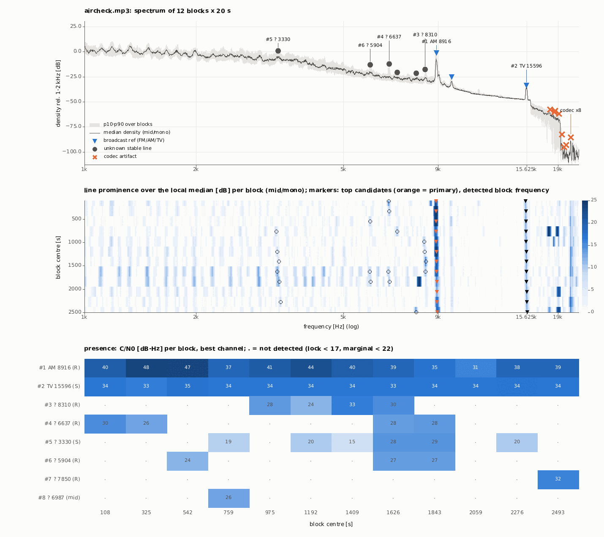
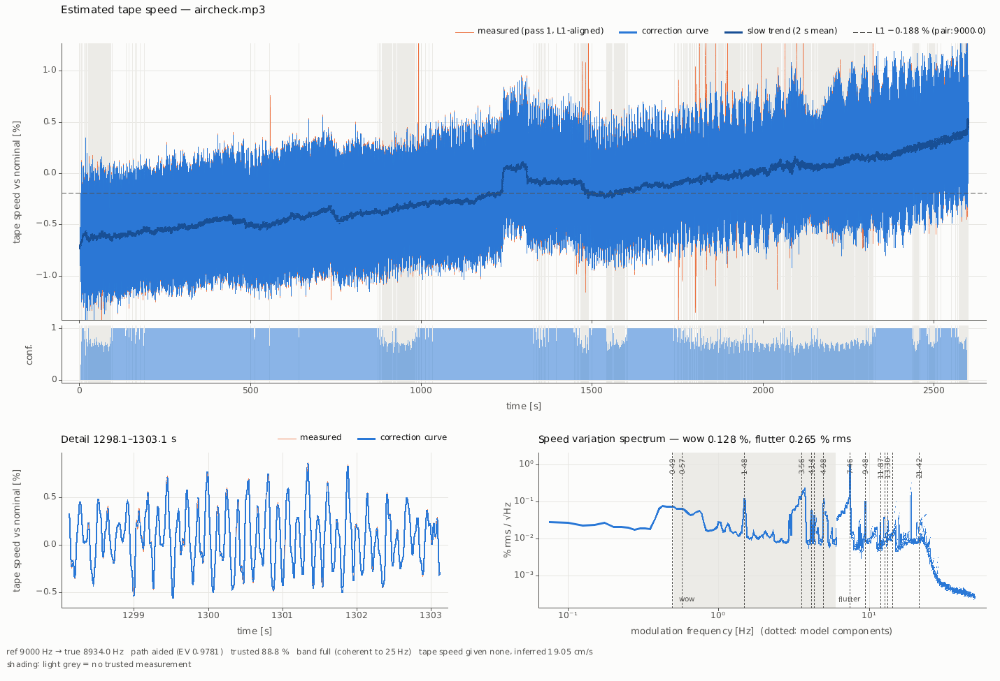
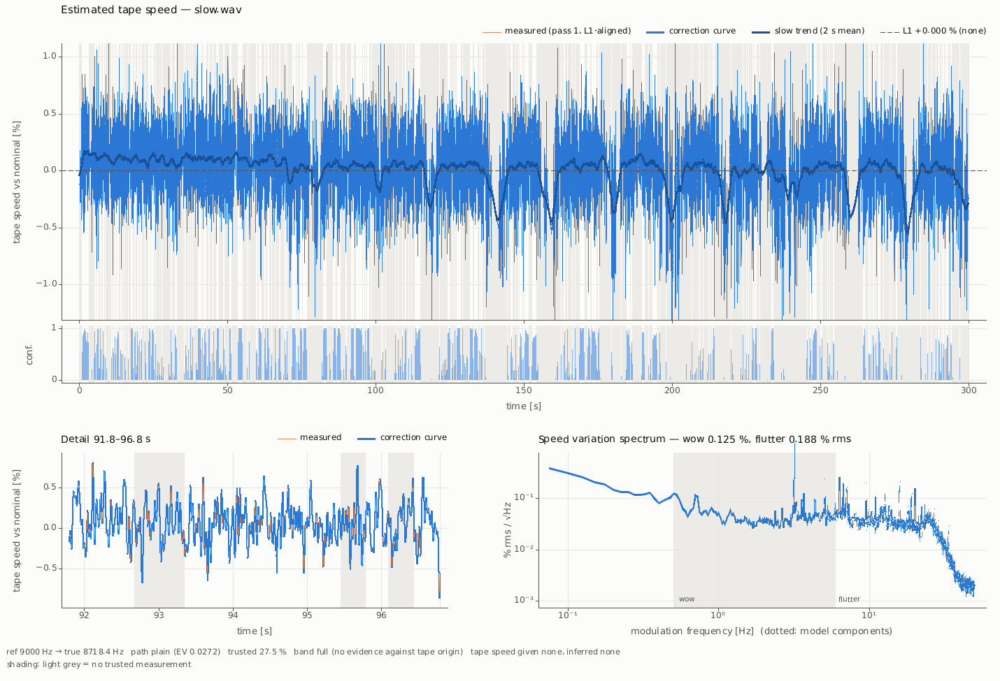
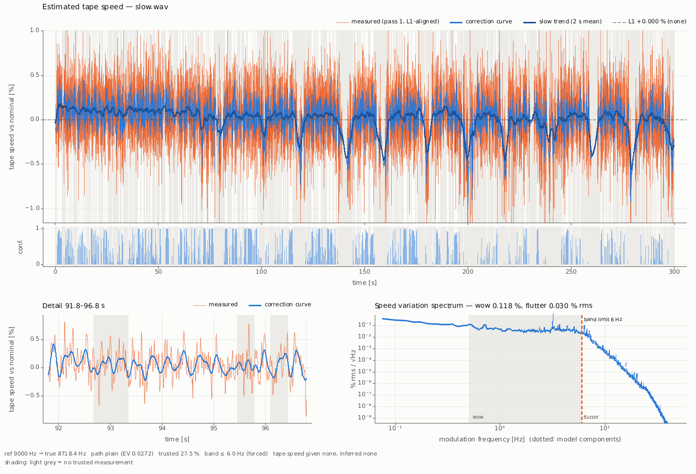

<p align="center"></p>

# tapespeed user guide

This guide is for people who have digitised cassettes, reel-to-reel tapes or old radio airchecks and want them
to play at the right, steady speed again. You should know what an MP3 or a FLAC file is and how to open a
terminal. You do not need to know signal processing.

The complete reference (every option, every file format, all measurements) is [MANUAL.md](MANUAL.md).
This guide explains the ideas, helps you choose the options, and shows how to read the results.

Contents: [1 The idea](#1-the-idea) · [2 Installation](#2-installation) · [3 What is on my tape?](#3-what-is-on-my-tape) ·
[4 Recipes](#4-recipes) · [5 Reading the results](#5-reading-the-results) · [6 Troubleshooting](#6-troubleshooting-and-faq) ·
[7 Limits](#7-limits) · [8 Glossary](#8-glossary)

## 1. The idea

### 1.1 Why tapes play at the wrong speed
A tape recorder pulls the tape past the head at a fixed speed, for example 4.76 cm/s on a cassette or 19.05 cm/s
(7½ inches per second) on a reel-to-reel machine. No machine does this perfectly, and the machine that plays the
tape back today is not the one that recorded it. Four kinds of error add up:

| error | what you hear | typical cause | how fast it changes |
|---|---|---|---|
| **offset** | the whole recording is a little too high or too low in pitch | the recorder or the player runs 1–3 % fast or slow | constant |
| **drift** | the pitch slowly creeps up or down over minutes | batteries running down; the reels changing size as tape winds from one to the other | minutes |
| **wow** | a slow "seasick" warble, like a warped record | a pinch roller that is not quite round, a sticky reel, a stretched belt | 0.5–6 times per second |
| **flutter** | a fast tremble or roughness, sustained notes sound "grainy" | the capstan (the spinning shaft that drives the tape) or a worn bearing | 6–25 times per second |

The numbers are small. In the Radio Caroline aircheck used throughout this guide the tape runs 0.19 % slow on
average, drifts by about 1 % over 43 minutes, and trembles by ±0.5 % seven and a half times per second. You hear
that last part as a rough, slightly gargling sound on every sustained note.

### 1.2 A speed ruler on the tape
To correct the speed you have to know what it was at every moment. tapespeed finds this out from a **reference
tone**: a steady whistle that was recorded on the tape by accident, together with the programme. Its true pitch is
known. When the tape runs 1 % fast, the whistle plays 1 % too high; when the tape trembles, the whistle trembles
with it. The whistle is a ruler that was recorded alongside the music.

| ruler | where it comes from | true pitch | how exact |
|---|---|---|---|
| **FM stereo pilot** | every FM stereo broadcast carries it; many tuners let a little of it through to the tape | 19000 Hz | exact (broadcast standard, ±2 Hz) |
| **AM beat whistle** | on medium wave, the station next door on the dial whistles against the one you listen to | 9000 Hz (Europe, Asia, Africa), 10000 Hz (Americas) | only as exact as the stations' frequencies (see [1.4](#14-the-absolute-pitch-problem-and-the-beat-pair)) |
| **TV line whistle** | a television set running in the same room, or TV sound itself | 15625 Hz (PAL/SECAM, Europe), 15734 Hz (NTSC, America/Japan) | exact (broadcast standard) |
| **test tone** | a calibration tone someone recorded on purpose | whatever was recorded | as exact as the tone generator |

Many adults cannot hear 15–19 kHz any more, so these tones are often on the tape without anyone knowing.
`tapespeed --survey` finds them for you ([section 3](#3-what-is-on-my-tape)).

### 1.3 What tapespeed does with the ruler
1. **Measure.** It follows the reference tone through the whole file and writes down how fast the tape was
   running, 200 times per second. That is the *speed curve*.
2. **Check.** It looks for patterns that a real tape machine produces (a capstan that turns 7.5 times per second,
   reels that slowly change size) and uses them to fill short gaps where the tone was lost. If there is a second
   reference tone, it checks that both tones wobble together, which proves the wobble comes from the tape.
3. **Correct.** It plays the recording back at exactly the inverse speed: where the tape ran 0.5 % fast, the
   output is slowed by 0.5 %. This happens in one single pass, so the sound is resampled only once.
4. **Clean up.** It removes the reference whistle from the result with a narrow filter (a *notch*), and on request
   cuts other whistles and Morse signals too.

The output has the same sample rate and number of channels as the input. Its length changes a little: a tape that
ran 0.19 % slow gives an output 0.19 % shorter.

### 1.4 The absolute pitch problem and the beat pair
The FM pilot and the TV whistle have exact, standard frequencies. With them tapespeed gets both the wobble *and*
the absolute speed right.

The AM beat is different. It is the difference between your station's frequency and its neighbour's. That is
exactly 9000 Hz only if both stations sit exactly on their channels. Offshore and pirate stations often did not:
in April 1979 Radio Caroline on 319 m was about 66 Hz off its channel, so its beat whistle was 8934 Hz, not
9000 Hz. If you tell tapespeed "the whistle should be 9000 Hz", it will make the whole recording 0.73 % too high.
The wobble is still removed correctly; only the overall pitch is off.

The fix is the **beat pair** (`--abs pair`). A station sits between *two* neighbours, one 9 kHz below and one 9 kHz
above. If the station is 66 Hz off, one beat is 9000 − 66 = 8934 Hz and the other 9000 + 66 = 9066 Hz. The
*average of the two* is exactly 9000 Hz, whatever the offset. When both neighbours are audible on the tape,
tapespeed measures both whistles and gets the absolute speed right without knowing the station's offset.

## 2. Installation

You need two things: **ffmpeg** (reads and writes audio files) and the **Rust toolchain** (builds tapespeed from
its source code). tapespeed is tested on macOS (Apple Silicon). Linux should work but has not been measured.

1. Install ffmpeg with your package manager, for example `brew install ffmpeg` on macOS with
   [Homebrew](https://brew.sh) or `sudo apt install ffmpeg` on Debian/Ubuntu. Check it:
   ```sh
   ffmpeg -version
   ffprobe -version
   ```
2. Install Rust from [rustup.rs](https://rustup.rs) (one command, follow the instructions on that page). You do
   not need to pick a version: the project pins its own (1.97.1). If the build complains that it is missing, run
   `rustup toolchain install 1.97.1`.
   On macOS you also need Apple's command line tools (`xcode-select --install`, once).
3. Build tapespeed. In a terminal, go to the `rust` folder of the tapespeed source and run:
   ```sh
   cargo build --release -p tapespeed
   ```
   The first build takes a few minutes. The program is then `target/release/tapespeed`.
4. Make the command `tapespeed` available in this terminal window (repeat in new windows, or add the line to your
   shell profile, `~/.zshrc` on macOS):
   ```sh
   export PATH="$PWD/target/release:$PATH"
   ```
5. Check that it works. The first command prints the list of options. The next two make a 60-second test
   recording with a known wobble and correct it:
   ```sh
   tapespeed --help
   tapespeed synth --preset fm19 --duration 60 -o test.flac
   tapespeed test.flac --ref 19000 -o test-fixed.flac
   ```
   The last line of the output starts with `audio test-fixed.flac:`. You now have `test-fixed.flac`,
   `test-fixed_speed.png`, `test-fixed_curve.csv` and `test-fixed_report.json`. Open the PNG: the blue curve is a
   regular wobble on a slowly falling line, the spectrum at the bottom right has sharp peaks near 0.55, 1.7 and
   4.3 Hz (the wobbles built into the test signal), and the footer says `trusted 99.5 %`.

All commands below assume that your terminal is in the folder with your recordings
(`cd ~/Music/tapes`, for example).

## 3. What is on my tape?

**Goal: find out which speed ruler your recording contains and which command to run.**

### 3.1 Run the survey
```sh
tapespeed aircheck.mp3 --survey
```
The survey listens to 12 short samples (20 s each) spread over the file, so it takes a few seconds even for a
two-hour tape. It writes no audio. It prints a report and saves a picture `aircheck_survey.png` and a data file
`aircheck_survey.json` in the current folder.

### 3.2 Read the survey
Below is the survey of a 43-minute Radio Caroline aircheck from 15 April 1979 (an MP3 of a reel-to-reel tape),
shortened. The parts that matter are marked with `<--`.

```text
SURVEY aircheck.mp3
  mp3 192 kb/s lossy | 44100 Hz | 2 ch | 2601.2 s | 12 blocks x 20.0 s = 240 s (9.2 %) | 1.5 s
  bandwidth: Nyquist 22050 Hz, cliff 18.1 kHz                            <-- nothing survives above 18.1 kHz

CANDIDATES                                                                <-- the tones it found
   #     f Hz class   nom   off %  pres  C/N0   ch prom ...  verdict
   1   8916.3 AM     9000  -0.930 12/12  39.4    R   21 ...  trackable    <-- AM beat, in all 12 samples, strong
   2  15595.7 TV    15625  -0.188 12/12  33.9    S   13 ...  trackable    <-- PAL TV whistle, also usable
   3   8310.0 ?         -       -  4/12  28.8    R   11 ...  unknown stable line | trackable, ref in 4/12 blocks
  ...
   9   9791.8 AM    10000  -2.082  7/12  25.1  mid    8 ...  no lock (trial track 1 % valid)

COHERENCE
      a Hz     b Hz    t0 s common %  0-0.5  0.5-6   6-25  same speed modulation
    8916.3  15595.7     512       48  0.968  0.992  0.986  yes (tape)      <-- both tones wobble together

PAIR
  -> found: d 65.97 Hz, beats 8934.03 / 9065.97 Hz, 3/3 trials, ...      <-- both neighbours audible

RECOMMEND                                                                 <-- the answer
  --ref         9000         #1 AM adjacent-channel beat (EU 9 kHz) at 8916.3 Hz, 12/12 blocks, ...
  --channel     mid          mid 39.3 dB-Hz within 3 dB of best (R 39.4)
  --abs         pair         beat pair 8934.03 / 9065.97 Hz true (d 65.97 Hz), 3/3 trials agree, ...
  --check-line  15625        TV line: independent cross-check of the pair L1 (both should agree)
  --lowpass     8000         AM: no programme above ~8 kHz; removes the other beats, the TV line and splatter ...
  --auto-notch  keyed        AM: Morse (CW) is common on medium wave; keyed mode notches on/off keyed lines ...
  cmd: tapespeed 'aircheck.mp3' --ref 9000 --abs pair --check-line 15625 --lowpass --auto-notch -o 'aircheck_corrected.flac'

PLAN (recommended options = the cmd: line, typed options win; --ref 9000, from survey #1 (--ref not given))
  ...

WARNINGS: none
```

What the columns in CANDIDATES mean:

| column | meaning | what to look for |
|---|---|---|
| `f Hz` | where the tone was found in your file | – |
| `class` | what it probably is: `FM` pilot, `AM` beat, `TV` line, `hum` (mains), `codec` (MP3 artefact), `?` unknown | `FM`, `AM` or `TV` near the top |
| `off %` | how far the found tone is from its standard pitch: a first guess at the speed error | a few tenths of a percent to about 3 % |
| `pres` | in how many of the 12 samples the tone was present | 12/12 is best; 4/12 means long stretches without it |
| `C/N0` | how strong and clean the tone is | 22 or more: usable; 17–22: marginal; below 17: not usable |
| `verdict` | the survey's conclusion | `trackable` |

You can **ignore** the columns `ch`, `prom`, `p5-p95 Hz`, `% wow`, `wcorr`, `trk %` and `s25 %`, the `LIMITS` block
(it only tells you which tones your file format can hold at all) and most of the `PLAN` block. The `PLAN` block
describes the run of the `cmd:` line step by step; its last two lines estimate time and memory. (If you type `--ref`
yourself, `PLAN` describes your own options instead, and `WARNINGS` lists each recommended option you left out.)
The `PRESENCE` block shows the strength of each tone in each sample; a dot means "not there", so expect gaps at
those times.

**What to do next:** copy the `cmd:` line and run it. It contains every option the survey recommends, and the
output is your file name with `_corrected` added (`aircheck_corrected.flac`), in the current folder. For an MP3
input the output is FLAC; for a WAV or FLAC input it keeps the format.

tapespeed never overwrites an input file: if an output name (audio, curve, report or plot) is one of the inputs,
also through a link, it stops before doing anything (`refusing to overwrite an input`). Other existing files with
the output names are replaced without asking.

### 3.3 The survey picture



*Survey of the Caroline aircheck. **Top:** the average sound spectrum from 1 kHz to 22 kHz. Blue triangles mark
broadcast rulers: the AM beat at 8916 Hz (the tall spike) and the TV whistle at 15596 Hz; the small triangle near
9.8 kHz is a 10 kHz beat that was too weak to follow. Grey dots are other steady tones of unknown origin; orange
crosses are MP3 artefacts above the 18 kHz cut-off. **Middle:** the same spectrum per sample, top to bottom = start
to end of the file. A ruler you can use is a dark vertical line all the way down, like the beat at 9 kHz and the TV
whistle at 15.6 kHz. **Bottom:** the strength (C/N0) of each candidate in each sample. Both rulers are present in
all 12 samples; the unknown tones come and go.*

### 3.4 Decision table

| what you have | what the survey shows | use | notes |
|---|---|---|---|
| FM radio recording, cassette or reel | `FM` near 19000 Hz, `trackable` | `--ref 19000` | absolute speed exact. [Recipe 4.1](#41-an-fm-recording) |
| AM / medium-wave aircheck, **both** neighbours audible | `AM` near 9000 Hz and `PAIR ... found` | `--ref 9000 --abs pair` | absolute speed from the beat pair. [Recipe 4.2](#42-an-am-aircheck-medium-wave) |
| AM aircheck, only one beat | `AM` near 9000 Hz, `PAIR ... not found` | `--ref 9000`, plus `--abs line:15625` if a `TV` line is there, else `--abs none` | wobble corrected; absolute pitch see [6.3](#63-the-absolute-pitch-seems-off) |
| American AM (10 kHz channels) | `AM` near 10000 Hz | `--ref 10000 --abs pair:10000` | untested on real recordings |
| TV sound, or a TV ran in the room | `TV` near 15625 or 15734 Hz | `--ref 15625` (or `15734`) | absolute speed exact. [Recipe 4.3](#43-a-tv-whistle) |
| a test tone | `?` at a steady frequency in 12/12 | `--ref <tone frequency>` | absolute speed as good as the tone |
| nothing usable | `RECOMMEND --ref - no usable line` | – | tapespeed cannot help this recording; see [6.2](#62-no-reference-found) |

The survey never recommends lines marked `hum` (50/60 Hz and their multiples): mains hum often comes from the
playback machine, not the tape, and then it does not show the tape's wobble.

## 4. Recipes

Every recipe writes four files next to the output: the corrected audio, `<name>_speed.png` (the speed plot),
`<name>_curve.csv` (the speed curve) and `<name>_report.json` (all numbers). Use **FLAC** for the output (`.flac`):
it is lossless and a third to half the size of WAV. See [6.7](#67-which-output-format) for other formats.

### 4.1 An FM recording
**Goal: correct a cassette or reel recorded from FM stereo radio.**

```sh
tapespeed cassette.flac --survey
tapespeed cassette.flac --ref 19000 -o cassette-fixed.flac
```
- `--ref 19000` tells tapespeed to follow the 19 kHz stereo pilot.
- The pilot is removed from the output automatically.

If the survey shows the pilot much stronger on one channel (column `ch` says `L` or `R`), analyse that channel; the
output still keeps both channels:
```sh
tapespeed cassette.flac --ref 19000 --channel L -o cassette-fixed.flac
```
The pilot needs a file with a sample rate of at least 40 kHz and no lossy cut-off below 19 kHz. Many MP3s cut
everything above 16–18 kHz, which removes the pilot (the survey's `LIMITS` block tells you). Digitise FM tapes to
WAV or FLAC at 44.1 or 48 kHz.

### 4.2 An AM aircheck (medium wave)
**Goal: correct a recording of a medium-wave station, with the 9 kHz beat whistle.**

Run the survey's suggestion. For an AM aircheck it is the full set:
```sh
tapespeed aircheck.mp3 --ref 9000 --abs pair --check-line 15625 --lowpass --auto-notch -o aircheck-fixed.flac
```

| option | what it does |
|---|---|
| `--ref 9000` | follow the 9 kHz beat whistle (search ±3 % around 9000 Hz; the survey adds `--search 0.04` or `0.05` when the tape runs further off) |
| `--abs pair` | get the absolute pitch from both neighbours' whistles ([1.4](#14-the-absolute-pitch-problem-and-the-beat-pair)); leave it out if the survey says the pair was not found |
| `--check-line 15625` | also follow the TV whistle, as an independent check that the wobble really comes from the tape |
| `--lowpass` | cut everything above 8 kHz. AM radio carries no programme there, only whistles and the neighbours' splatter |
| `--auto-notch` | find Morse code (on/off keyed tones) in the result and notch it out only where it is present. The survey always suggests it for AM: it cannot see Morse in the uncorrected samples, and on a recording without Morse it changes nothing |

On this 43-minute file the full set takes about 40 seconds on an Apple M1 Max.
Both `--auto-notch` and `--lowpass` can take an optional value. Put them directly before another option (here
`-o`) or at the very end, or attach a value with `=` (`--lowpass=7000`). Otherwise
`--auto-notch aircheck.mp3` would be read as the value "aircheck.mp3".

**Weak reception.** When the station fades in and out, or another station on the same channel interferes, the
receiver itself adds a fast wobble to the beat that was never on the tape. Correcting that wobble would *add*
flutter to the programme. `--weak-rf` tells tapespeed to correct only the slow part (up to 6 Hz), plus regular
mechanical flutter it can identify:
```sh
tapespeed weak.wav --ref 9000 --abs pair --weak-rf -o weak-fixed.flac
```
Use it when the plot looks like [5.3](#53-a-suspicious-plot): many grey gaps, a featureless spectrum.

**Other choices for the absolute pitch** (more in [6.3](#63-the-absolute-pitch-seems-off)):
```sh
tapespeed aircheck.mp3 --ref 9000 --abs line:15625 -o aircheck-tv.flac
tapespeed aircheck.mp3 --ref 9000 --abs none -o aircheck-steady.flac
```
- `--abs line:15625` takes the absolute pitch from the TV whistle instead of the pair.
- `--abs none` removes the wobble and drift but keeps the recording's average speed as it is.

### 4.3 A TV whistle
**Goal: correct TV sound, or any recording with a TV running nearby.**
```sh
tapespeed aircheck.mp3 --ref 15625 -o aircheck-tv-ref.flac
```
Use `--ref 15734` for American and Japanese (NTSC) TV. The TV whistle has an exact standard frequency, so the
absolute speed is right. It needs a sample rate of at least 33 kHz.

### 4.4 A whole folder
**Goal: correct many files with the same settings in one go.**

Survey them all first. With several files, `-o` names a folder:
```sh
tapespeed tapes/*.mp3 --survey -o surveys/
```
Look at each `RECOMMEND` block. Files that need the same options can run together:
```sh
tapespeed tapes/*.mp3 --ref 9000 --abs pair --lowpass --auto-notch -o fixed/
```
- `-o fixed/` creates the folder and writes `fixed/<name>.flac` plus the side files for each input. With several
  inputs `-o` is always a folder (or a `{stem}` pattern, below); a name with an audio ending such as `-o all.flac`
  is refused with a hint.
- Several files run at the same time, as many as memory allows.
- If one file fails (for example `--abs pair` finds no partner in it), the others still finish. The failing file is
  named on screen, and the last line says `batch: 2 files, 1 ok, 1 failed`. Run that file again separately,
  without `--abs pair`.
- Two inputs with the same name (e.g. `side1/tape.mp3` and `side2/tape.mp3`) are refused, because their outputs
  would collide.

To choose another output format or naming pattern, use `{stem}` for the input name:
```sh
tapespeed tapes/*.mp3 --ref 9000 -o fixed-wav/{stem}-fixed.wav
```

### 4.5 A very long file on a small computer
**Goal: process a two-hour tape on a laptop with 8 or 16 GB of memory.**

tapespeed holds the whole recording in memory and uses all processor cores. A 43-minute stereo file needs about
4–7 GB; by default tapespeed allows itself 80 % of the memory that is free when it starts. If the estimate does not
fit, it automatically moves the decoded audio to a temporary file on disk and works more slowly but with less
memory. You can set the limit and the place for that temporary file yourself:
```sh
mkdir -p tmp
tapespeed aircheck.mp3 --ref 9000 --abs pair --max-ram 3G --tmp-dir tmp -o aircheck-fixed.flac
```
- `--max-ram 3G` sets the memory target (also `500M` or `50%` of the free memory). It is a target for planning, not
  a hard limit (see below).
- `--tmp-dir tmp` puts the temporary file in the folder `tmp`; it must exist and needs about 1.3 GB of free space
  per hour of stereo audio. Use a fast internal disk. The file is deleted automatically.
- `--threads 4` would use only four processor cores, if you want to keep the computer responsive.

The first line of the output shows what tapespeed decided:
```text
memory: mode spill (tmp), bw 1/5 parallel, est peak 2.3 GiB, budget 3.0 GiB (--max-ram, 32.3 GiB available), jobs 1, threads 10
```
`mode spill` means the temporary file is in use; `mode ram` means everything fits in memory. The results are
identical either way. The budget is a planning target, not a hard limit: the activity monitor may show somewhat
more (here 3.9 GB), because the operating system counts the temporary file's cached pages too. Roughly, a 16 GB
machine handles files up to about three hours.

### 4.6 A tape transferred at the wrong speed
**Goal: a tape recorded at 9.5 cm/s was digitised on a machine running at 19 cm/s.**
```sh
tapespeed halfspeed.flac --ref 9000 --tape-speed 9.53cm --play-speed 19.05cm -o halfspeed-fixed.flac
```
`--tape-speed` is the speed the tape was recorded at, `--play-speed` the speed of the transfer. tapespeed then looks
for the 9 kHz whistle at 18 kHz and slows the result down by a factor of two. Speeds can be written as `19.05cm`,
`7.5ips` or `1 7/8 ips` (in quotes, because of the spaces).

For a reel-to-reel tape that was played at its correct speed, `--tape-speed 19.05cm` is optional; tapespeed can
usually work out the speed from the reel and capstan pattern itself (see [5.1](#51-the-screen-summary)).

## 5. Reading the results

### 5.1 The screen summary
**Goal: tell in ten seconds whether the run went well.** The full AM run from [4.2](#42-an-am-aircheck-medium-wave)
prints this (shortened):

```text
memory: mode ram, bw 5/5 parallel, est peak 6.6 GiB, budget 25.6 GiB (80 %, 32.0 GiB available), jobs 1, threads 10
analyze 9000 Hz (centre 9000): bw auto:45, valid 75.1 %                                 (1)
analyze 15625 Hz: bw auto:45, valid 74.5 %
pair (9000 Hz spacing, |d| <= 300 Hz): none: single survivor                            (2)
beat switching (rho 1.014768): 8 span(s), 14 s on the other beat, repaired to the lo beat
model: path aided (EV 0.98 >= 0.7)                                                      (3)
  capstan (f7.461, 7.461 Hz): d 8.13 mm
  pack: R_full 8.1 cm (~7" reel), play time 59 min if file starts at tape start, h take-up/supply 1.55
evidence: fading rho 0.34 (...), coherence with 15625 Hz: 0-0.5:0.996 0.5-6:0.998 6-25:0.995 -> correction band full (coherent to 25 Hz)   (4)
L1 (pair:9000.0): mean speed 0.998122 (-0.188 %), implied true line 8934.0 Hz; ... cross-check 15625:+7.2 ppm; tape speed given none, inferred 19.05 cm/s   (5)
curve aircheck-fixed_curve.csv: path aided, EV 0.9781, valid 88.8 %, ratio 0.98341..1.01331                     (6)
reference tone not needed: in lowpass stopband (>= 8250 Hz)
notch 8021.1 Hz (auto, width 150 Hz): 220 s in 3 span(s), present 139 s, SNR 36 dB, keying contrast 36.5 dB  (7)
lowpass 8000 Hz (transition ±250 Hz, 80 dB)
audio aircheck-fixed.flac: 2601.247 s -> 2596.361 s @ 44100 Hz; 40 s total (0.9 min per hour of audio)
```

| line | what it tells you | good | worrying |
|---|---|---|---|
| (1) `analyze ... valid` | share of the file where the ruler was measured reliably in the first pass | above 70 % | below 30 % |
| (2) `pair ...` | the beat pair result; the table under it (not shown) lists every candidate and why it was rejected | `none: single survivor` = no doubt | an error message: run without `--abs pair` |
| `beat switching` | short stretches where the receiver's whistle came from the *other* neighbour; tapespeed found and repaired them | any number, it is handled | – |
| (3) `model: path aided` | tapespeed found a mechanical pattern explaining 98 % of the wobble (EV 0.98) and used it to measure more precisely and fill gaps. Here it even worked out a 7.46 Hz capstan, a 7-inch reel and 19.05 cm/s | `aided` | `plain` with EV near 0 means no recognisable machine pattern: often noise |
| (4) `evidence` | do the two rulers wobble together (coherence, 1.0 = perfectly)? How much of the wobble is corrected? | `coherent to 25 Hz`, coherence well above 0.5 | `no coherent band`: the wobble may come from the radio path, not the tape |
| (5) `L1` | the average speed: here the tape ran 0.188 % slow. The TV whistle agrees with the beat pair to 7 parts per million | `cross-check` within ±100 ppm (0.01 %) | – |
| (6) `curve ... valid` | share of the file with a trusted measurement after all steps | above 70 % | below 30 % |
| (7) `notch ...` | a Morse signal at 8021 Hz was found and notched in 220 seconds of the file | – | – |
| `audio` | output written; 43 min in → 0.19 % shorter out; time taken | – | – |

Lines starting with `line ... steady ... kept` are steady tones that `--auto-notch` found but deliberately left
alone, because they are not Morse. The model's long component table and the `tape speed: inferred; ...` line can be
skipped.

A `WARNING: no usable reference for ... s` line means long stretches (20 s or more) without the ruler. There,
only the slow drift is corrected, not the wobble. See [7](#7-limits).

### 5.2 The speed plot
**Goal: see what was measured and judge whether it is believable.** Every run writes `<name>_speed.png`.



*Speed plot of the Caroline aircheck (`--abs pair --check-line 15625 --lowpass --auto-notch`), a good result.*

**Top panel: the speed over the whole file**, in percent away from the correct speed. Above zero means the tape
ran too fast (pitch too high), below zero too slow.

| element | meaning | in this example |
|---|---|---|
| **blue** (correction curve) | the speed that tapespeed corrects for | a thick band: the ±0.5 % flutter, too fast to see individually at this scale |
| **orange** (measured) | the raw first measurement; it shows only where it differs from blue | hidden behind blue almost everywhere: good |
| **dark blue line** (slow trend) | the average over 2 seconds: drift and slow wow | rises from −0.6 % to +0.4 % over 43 min, typical of a reel-to-reel |
| **dashed line** (L1) | the average speed over the whole file | −0.188 % |
| **light grey areas** | no trusted measurement; tapespeed filled the curve from its model | some at the start and between 1750 and 2320 s |
| **conf. strip** | how sure the measurement is (0 to 1), as a filled band. Full height means "sure" | notches and empty stretches are where the measurement drops out; they match the grey areas |

The step in the trend near 1240 s (up by 0.25 %, back down near 1470 s) is real: the independent TV whistle
shows the same step. Perhaps the recorder was stopped and restarted.

**Bottom left: a 5-second detail.** Here you can see the individual wobbles: about 7.5 per second, the capstan.
Orange and blue lying on top of each other means the final curve follows the measurement.

**Bottom right: the wobble spectrum.** This shows which wobble speeds are present. The title gives the two summary
numbers: **wow 0.128 %** (slow wobble, 0.5–6 Hz, grey zone) and **flutter 0.265 % rms** (fast wobble,
6–25 Hz). These describe how much the *tape* wobbled, i.e. what was removed. Sharp peaks are mechanical parts
turning at a fixed rate; dotted lines mark the ones tapespeed identified (here 1.48 Hz, a roller, and 7.46 Hz, the
capstan). Above 25 Hz the curve drops: tapespeed does not measure or correct faster wobble.

For orientation: hi-fi cassette decks were specified at about 0.05–0.15 % wow and flutter (measured with a
different weighting, so compare loosely); 0.2 % and more is clearly audible on piano and sustained notes.

**A good plot:** orange hidden behind blue; little grey; sharp peaks in the spectrum; the footer says
`path aided` and `trusted` well above 70 %.

### 5.3 A suspicious plot
**Goal: recognise a measurement you should not trust fully.**

This is a 5-minute excerpt of another aircheck from the same collection, with weak, fading reception (`slow.wav`). Its beat is
3.1 % below 9000 Hz, just outside the default search range of ±3 %, so the survey suggests a wider one
(`--search 0.04`; 0.05 below works as well, see [6.2](#62-no-reference-found)):
```sh
tapespeed slow.wav --ref 9000 --search 0.05 --abs none -o slow-fixed.flac
tapespeed slow.wav --ref 9000 --search 0.05 --abs none --weak-rf -o slow-weakrf.flac
```



*Without `--weak-rf`. Warning signs: grey (untrusted) areas everywhere, `trusted 27.5 %` in the footer,
`path plain (EV 0.0272)`: no machine pattern found. The spectrum on the right is a flat, featureless plateau up to
25 Hz instead of sharp peaks: that is what measurement noise looks like. "Correcting" it would add a fast tremble
of about 0.19 % to the programme.*



*The same file with `--weak-rf`. The blue correction curve now follows only the slow part (the dark blue trend);
the orange raw measurement shows how much fast noise was left out. The spectrum is cut at the orange line
"band limit 6 Hz", and flutter drops from 0.188 % to 0.030 %. The slow wow (0.12 %) is still corrected. The regular
dips in the trend, every 20 seconds or so, may be real or may come from the fading; listen before you trust them.*

**Signs of trouble:**
- `trusted` (or `valid`) below about 30 %, grey everywhere;
- a flat spectrum without peaks;
- orange spikes far outside the blue band;
- the slow trend jumping by more than 0.3 % in a step at the edge of a grey area;
- the corrected audio sounding more wobbly than the original.

What to do then: [6.1](#61-the-result-sounds-wobbly-or-worse).

### 5.4 The curve CSV and the report
`<name>_curve.csv` holds the speed curve: one row every 5 ms with time, speed ratio (1.002 = 0.2 % fast),
confidence and a 0/1 "trusted" flag; the lines starting with `#` record the settings. `<name>_report.json` holds
every number from the screen summary. You only need them for your own analysis or to re-use a curve; both are
described in [MANUAL.md §8](MANUAL.md#8-outputs).

## 6. Troubleshooting and FAQ

### 6.1 The result sounds wobbly, or worse
1. **Open the speed plot** and compare it with [5.3](#53-a-suspicious-plot). Little trusted, flat spectrum: the ruler
   is too weak. Try `--weak-rf` (AM). It keeps the wow correction and drops the untrustworthy flutter correction.
2. **Wrong ruler?** Check that the `--ref` you used is a line with class `FM`, `AM` or `TV` and `12/12` presence in
   the survey. A tone added by the playback machine or the sound card does not wobble with the tape, and following
   it does nothing useful.
3. **Another channel.** If the survey's `ch` column shows the ruler mainly in `L`, `R` or `S`, try `--channel L` (or
   `R`, `S`).
4. **Cross-check.** If the survey lists a second usable ruler, add `--check-line <its frequency>`. tapespeed then only
   corrects the wobble speeds where both rulers agree, and the `evidence` line tells you how far that is.
5. **Gaps.** In gaps of 20 s or more without the ruler only the drift is corrected, not the wobble
   ([7](#7-limits)). The `WARNING: no usable reference` line lists those times.

### 6.2 "No reference found"
The survey ends with:
```text
RECOMMEND
  --ref         -            no usable line (C/N0 >= 17 dB-Hz survey scale, not codec/hum)
WARNINGS
  ! no usable reference line found: --ref required, run would fail or track noise
```
Possible reasons:
- **The file cannot hold it.** The survey's `LIMITS` block says e.g. `FM stereo pilot ... above cliff 18.1 kHz ->
  removed by the codec`. If you still have the tape, digitise it again as WAV/FLAC at 44.1 or 48 kHz.
- **It was filtered.** Many FM tuners and cassette decks have a filter against the 19 kHz pilot (an "MPX filter").
- **It is there but off-centre.** A tape that runs more than 3 % off speed puts the whistle outside the default
  search range. The survey still recognises a 9 kHz beat up to 6 % off (label
  `... at -3.12 %: outside --search 3 %, needs --search 0.04`) and puts the wider search into the `cmd:` line
  (`--ref 9000 --search 0.04`). For other tones it only adds a note `(... % from 19000 Hz: outside --search 3 %?)`;
  then try `--search 0.05` (±5 %) yourself.
- **There is none.** Then tapespeed cannot correct this recording. Do not force it with `--ref 9000` anyway: it would
  follow noise, and the result would be a random wobble. In a batch of 17 real Caroline airchecks, 5 had a ruler in
  less than a quarter of the file and were not usable.

### 6.3 The absolute pitch seems off
The wobble and drift can be right while the overall pitch is a little off. That happens when the true frequency of
the ruler is not known ([1.4](#14-the-absolute-pitch-problem-and-the-beat-pair)):

| `--abs` | the average speed comes from | when to use |
|---|---|---|
| `ref` (default) | assumes the ruler is exactly `--ref` | FM pilot, TV whistle, test tone. For AM only if the stations were on their channels |
| `pair` | both AM neighbours' whistles | AM, survey says `PAIR ... found` |
| `line:15625` | a second, exact ruler (TV whistle, FM pilot) | AM with a TV whistle on the tape |
| `none` | keeps the recording's average speed; only wobble and drift are removed | AM with no second reference: honest "don't know" |
| `assume:8934` | you know the true whistle frequency (e.g. from another recording of the same station on the same day) | AM, repeated recordings |
| `percent:-0.5` | you set the average speed yourself (here 0.5 % slow) | you know it from elsewhere, e.g. a known song |

Real examples from the Caroline batch: on 15 April 1979 the station was 66 Hz off its channel (beat 8934 Hz,
0.73 % low); the Mi Amigo/Caroline transmitter in January 1978 was 39 Hz off (0.43 %). With the default `--abs ref` these recordings
would end up 0.73 % and 0.43 % off in pitch, which people notice in music they know well.
If you cannot use `pair` or `line:`, `--abs none` is the safe choice.

If `--abs pair` fails, tapespeed stops with a message like
`--abs pair: no partner line passing the criteria within |d| 5-300 Hz of the primary at 8718.95 Hz (no candidate)`
and a table of what it looked at. Run again without `--abs pair`.

### 6.4 The whistle is still audible
- The whistle tapespeed *followed* is removed automatically (the line `reference tone notched at ... Hz`).
- On AM there are usually more whistles: the other neighbour's beat, a 10 kHz beat, a TV whistle. `--lowpass`
  removes everything above 8 kHz at once; AM radio has no programme there. Use `--lowpass=7000` for a lower limit.
- Single whistles at known frequencies can be notched over the whole file. The frequencies are those *after*
  correction (the true ones, e.g. 9066 for the upper Caroline beat):
  ```sh
  tapespeed aircheck.mp3 --ref 9000 --abs pair --notch-at 9066,15625 -o aircheck-notched.flac
  ```
- `--keep-ref` does the opposite: it leaves the followed whistle in the output.

### 6.5 Morse code in the background
Morse (CW) from coastal and ship radio stations is often audible on medium-wave airchecks as a beeping tone.
`--auto-notch` finds tones that switch on and off like Morse and notches them only in the 5-second blocks where
they are present, so the programme is untouched elsewhere. In the Caroline example it
found Morse at 8021 Hz (minutes 27–31) and notched 220 seconds. Steady tones are left alone; `--auto-notch all`
removes those as well. If you know the frequency, a whole-file notch is simpler:
```sh
tapespeed aircheck.mp3 --ref 9000 --abs pair --notch-at 8021 -o aircheck-nocw.flac
```
Each notch removes a 150 Hz wide slice of sound around that frequency (`--notch-width` changes that).

### 6.6 It runs out of memory, or it is slow
- Use `--max-ram` and `--tmp-dir` ([4.5](#45-a-very-long-file-on-a-small-computer)).
- Close other large programs; tapespeed's default budget is 80 % of the memory that is free *when it starts*.
- Typical times on an Apple M1 Max: survey 1–2 s per file; correction 20–45 s for 43 minutes; 17 files (18 hours)
  in under 5 minutes. `--auto-notch` and `--abs pair` each add some time. A slower computer takes longer, but the
  results are identical.
- `--threads 2` makes it slower but keeps the computer usable meanwhile.

### 6.7 Which output format?
| `-o` ending | result | when |
|---|---|---|
| `.flac` | lossless, 24 bit | recommended: archive and further editing |
| `.wav` | lossless, 32-bit floating point; large (about 900 MB for 43 min stereo) | if your editor does not read FLAC |
| `.mp3` | lossy, LAME VBR quality 2 (about 190 kb/s for stereo) | for listening; tapespeed prints a `note:` that the file is lossy |
| `.m4a`, `.aac` | lossy AAC, 128 kb/s per channel | for listening |
| `.opus` | lossy Opus, 80 kb/s per channel, always 48 kHz | for listening |
| `.ogg` | Vorbis quality 6 (about 192 kb/s) if your ffmpeg has it, otherwise lossless FLAC inside Ogg | – |

Every lossy encoding loses a little quality, and your MP3 input already did once. Keep a FLAC as the master and
make listening copies from it.

The sample rate and the number of channels are always the same as the input (except Opus, which only knows 48 kHz).

### 6.8 Error messages
| message | meaning |
|---|---|
| `--ref and -o are required (except with --survey)` | add `--ref` and `-o` |
| `invalid value 'x.mp3' for '--auto-notch [<AUTO_NOTCH>]'` | `--auto-notch` (or `--lowpass`) stood directly before the input name; move it to the end |
| `ffprobe failed ... No such file or directory` | input name misspelt, or ffmpeg not installed |
| `--play-speed needs --tape-speed (the recording speed)` | give both speeds |
| `with several inputs -o is a directory or contains {stem}` | in a batch, `-o` must be a folder or contain `{stem}` (`-o all.flac` is not a folder) |
| `audio output x.flac is the input file x.flac: refusing to overwrite an input` | choose another output name; nothing was written. `--overwrite` allows it, but then the original is gone |
| `warning: --channel S on a mono file: analysing the mono signal` | a mono file has no left, right or side channel; tapespeed uses the mono signal |

More in [MANUAL.md §13](MANUAL.md#13-exit-codes-and-messages).

### 6.9 What tapespeed cannot fix
tapespeed corrects **speed only**. It does not remove hiss, crackle, hum or distortion, does not restore lost
treble, does not repair dropouts in level (the sound getting quiet for a moment), and does not fix print-through
(pre-echo) or a misaligned tape head. Use a restoration program for those, preferably *after* tapespeed, because the
speed correction should be the first resampling step.

## 7. Limits

| situation | what happens |
|---|---|
| **short dropouts** of the ruler (up to a few seconds) | the gap is filled from the mechanical pattern (when tapespeed found one) or from the surrounding measurement. The plot shades it grey. Usually inaudible |
| **long gaps**, 20 s or more without the ruler | only the slow drift is corrected, by a straight line between the edges of the gap (at the ends of the file: a ramp to the average speed). Wow and flutter stay in there. The screen shows a `WARNING: no usable reference ...` line with the times |
| **fading on AM** | the radio path adds its own fast wobble to the whistle. Without a second ruler tapespeed cannot fully separate it from tape flutter; it limits the correction automatically only in clear cases. Use `--weak-rf` when in doubt |
| **flutter faster than 25 Hz** | not measured, not corrected. It sounds like roughness rather than wobble |
| **no ruler at all** | nothing to measure: tapespeed cannot correct the recording |
| **weak ruler** | below a certain strength (survey C/N0 about 17–22) the measurement fails or becomes noise |
| **absolute speed on AM** | right only with `--abs pair` or a second exact ruler; otherwise off by the station's offset (0.4–0.7 % in the Caroline batch) |
| **file edges** | the first and last 0.15 s keep the speed of their neighbourhood |
| **short files** | under 60 s, or with less than 20 % trusted measurement, the mechanical model is skipped and gaps are filled less well |

Measured on synthetic test recordings with a known speed curve, the remaining speed error after correction is
about 0.001 % for FM-pilot recordings and about 0.01–0.02 % for AM. On the 43-minute Caroline tape, the beat pair
and the TV whistle, two completely independent rulers, agree on the average speed to 0.0007 %.

## 8. Glossary

| term | meaning |
|---|---|
| **aircheck** | a recording of a radio broadcast made by a listener |
| **beat, beat whistle** | the whistle you hear when two radio stations are close on the dial; its pitch is the difference of their frequencies |
| **beat pair** | the two beats from the neighbours below and above a station; their average is exactly the channel spacing |
| **capstan** | the spinning shaft in a tape machine that pulls the tape at constant speed; the main source of flutter |
| **channel (`--channel`)** | which part of a stereo file is analysed: `mid` (left + right), `L`, `R`, or `S` (left − right); a mono file is always analysed as it is |
| **C/N0** | how strong a tone is compared with the noise around it, in dB-Hz; higher is better |
| **coherence** | how closely two rulers wobble together, 0 to 1; above 0.5 means the wobble comes from the tape |
| **drift** | slow speed change over minutes |
| **EV** | "explained variance": how much of the wobble the mechanical model explains, 0 to 1 |
| **FLAC** | lossless compressed audio format |
| **flutter** | fast speed wobble, 6–25 times per second (here: rms in percent) |
| **FM pilot** | the 19 kHz tone in every FM stereo broadcast |
| **Hz, kHz** | vibrations per second; 1 kHz = 1000 Hz |
| **L1** | tapespeed's name for the average speed over the whole file |
| **lowpass** | a filter that removes everything above a frequency |
| **notch** | a filter that removes a narrow slice around one frequency |
| **ppm** | parts per million; 10 ppm = 0.001 % |
| **raster, channel spacing** | the fixed distance between broadcast frequencies: 9 kHz in Europe, 10 kHz in the Americas |
| **reference tone, ruler** | a tone of known pitch recorded on the tape, used to measure the speed |
| **resampling** | recomputing the audio at a different speed; tapespeed does it once, with a varying speed |
| **rms** | root mean square, a kind of average size of a wobble |
| **spill** | moving the decoded audio to a temporary file when memory is short |
| **survey** | tapespeed's quick look at a file to find usable rulers (`--survey`) |
| **TV line whistle** | the 15625 Hz (PAL) or 15734 Hz (NTSC) whine of a TV set's picture scanning |
| **valid, trusted** | parts of the file where the speed was measured reliably |
| **wow** | slow speed wobble, 0.5–6 times per second |
