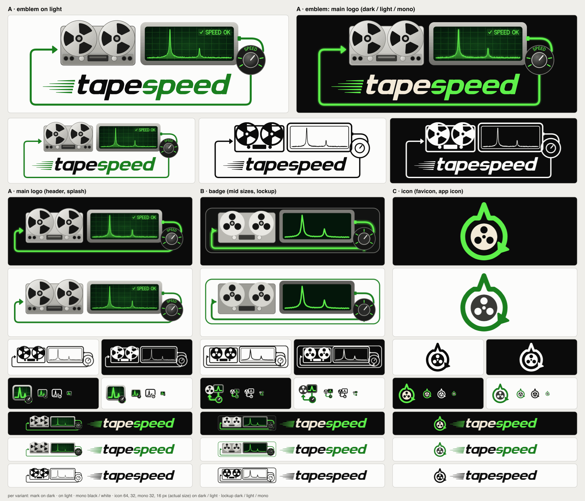

# tapespeed logo

The logo shows what the tool does. A tape deck plays and a spectrum scope
measures the reference tone. A cable carries that measurement to a SPEED knob
and back into the deck. The family comes in three levels of detail.



## Which variant where

| variant | use it for | minimum size |
|---|---|---|
| **A: main logo**: `A/emblem*.svg`, plus `A/mark*`, `A/lockup*` | README header, splash screen, title slide, website hero, stickers | emblem ≥ 480 px wide (≈ 100 mm in print); below that the "SPEED OK" label and the knob text stop being legible |
| **B: badge**: `B/mark*`, `B/lockup*` | mid sizes: docs sidebar, about dialog, release notes, slides, the horizontal lockup in running text | mark ≥ 160 px wide; lockup ≥ 40 px tall |
| **C: icon**: `C/icon*`, `C/mark*`, `C/lockup*` | favicon, app/dock icon, avatar, small-print mark, terminal/CLI banners | ≥ 16 px (it reads best from 32 px up); lockup ≥ 24 px tall |

Between the minimum sizes, step down a level: use A down to its minimum, then
B, then C.

### Files in A/, B/, C/

| file | background |
|---|---|
| `*.svg` (no suffix) | dark, the primary version |
| `*-light.svg` | light |
| `*-mono.svg` | any; one colour, #0b0b0b. Recolour the single fill to #fcfcfb (or any solid colour) for dark backgrounds, engraving, embroidery, fax. |

Each variant has `mark`, `icon` (a square 64-unit grid) and `lockup` (mark plus
wordmark side by side). A also has `emblem`, the stacked main logo.

All SVGs are filled outlines only: no strokes, no fonts and no external images.
They scale freely and import cleanly into Inkscape, Figma, Illustrator and
laser or vinyl cutters.

### Raster exports (`png/`)

| file | content |
|---|---|
| `favicon.ico` | C on #0b0b0b, 16/32/48 px |
| `apple-touch-icon.png` | C on #0b0b0b, 180 px, opaque |
| `icon-dark-N.png`, `icon-light-N.png` | C, transparent background, N = 16, 32, 48, 64, 128, 256, 512 |
| `header-dark.png`, `header-light.png` | A emblem at 1600 px wide, transparent background (README header) |
| `social-preview.png` | A emblem on #0b0b0b, 1280 × 640 (GitHub social preview) |

Example README header with automatic dark/light switching:

```html
<picture>
  <source media="(prefers-color-scheme: dark)" srcset="docs/logo/png/header-dark.png">
  
</picture>
```

## Clear space

- **A, B and lockups:** keep at least the x-height of the wordmark free on every
  side. That is the height of the "a" in "tape".
- **Marks without a wordmark:** keep at least 1/10 of the mark's height free.
- **C:** keep at least 1/8 of the icon's width free. The icon grid already
  contains about 1 unit of margin out of 64.

Do not place anything inside the cable loop.

## Colours

| role | dark background | light background |
|---|---|---|
| background (reference) | ink #0b0b0b | surface #fcfcfb |
| "tape" in the wordmark | cream #f3ead8 | ink #0b0b0b |
| "speed", cable, arrows, knob plate, outlines | phosphor green #5ef04a | dark green #1a7f1f |
| scope trace, grid, knob ticks, labels (on the dark screen or dial) | phosphor green #5ef04a | phosphor green #5ef04a |
| scope screen | #04160a | #04160a |
| steel (deck, bezel, rollers) | #e9e8e3, #b9b8b2, #7d7c77, #3a3a37 | #d6d5cf, #9d9c96, #5f5e5a, #2e2e2c |
| knob dial | #141413 | #1b1b1a |
| reel (C) | cream #f3ead8 | #3a3a37 |

**Light-background rule.** Phosphor green #5ef04a has only a 1.5 : 1 contrast
ratio against white. On light backgrounds, every green that sits directly on the
page is replaced by #1a7f1f (5.0 : 1 on #fcfcfb). Bright green is used only where
it sits on the dark scope screen or the dark knob dial, which carry their own
background. Never put #5ef04a text or thin lines on a light background.

Glow appears only in A on dark backgrounds, as a blur filter on the cable and the
trace. B replaces it with a single translucent halo stroke, and C has none.

## Wordmark

The heavy, slanted (14°), two-tone "tapespeed" is custom lettering built from
rounded geometric shapes. It is not set in a typeface, so no font licence is
involved. "tape" is cream (ink on light) and "speed" is green. The five tapered
speed lines on the left are optional; drop them when space is tight.

## Regenerating

All SVGs, PNGs, the ICO and the contact sheet come from the scripts in `src/`:

```
python3 -m venv /tmp/logo-venv && /tmp/logo-venv/bin/pip install shapely   # shapely >= 2
docs/logo/src/export.sh /tmp/logo-venv/bin/python
```

| file | job |
|---|---|
| `src/build.py` | the generator (all geometry and colours) |
| `src/outline.py` | turns strokes into filled outlines |
| `src/sheet.py` | lays out the contact sheet |
| `src/export.sh` | runs everything and writes the PNG/ICO exports |

The tools needed are shapely, `rsvg-convert` (librsvg) and ImageMagick 7.
Running `build.py` with `TAPESPEED_LOGO_STROKES=1` writes the raw stroked SVGs,
which is useful when editing.

## Licence

The logo, its SVG and PNG files and the generator scripts are part of the
tapespeed project and are licensed under GPL-3.0, the same as the code.
